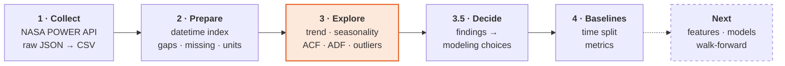

<div align="center">

# 🌤️ Cairo Weather: Time-Series Analysis and Forecasting Setup

**36 years of daily weather data for Cairo, from the NASA POWER API to a forecast-ready analysis**

[](https://www.python.org/)
[](https://jupyter.org/)
[](https://pandas.pydata.org/)
[](https://www.statsmodels.org/)
[](https://power.larc.nasa.gov/)

</div>

---

## 📌 Overview

This project collects **13,149 days (1990–2025)** of weather data for Cairo, Egypt, through the NASA POWER API. It then cleans the data and runs time-series EDA on it, focused on one question:

> **What must a model learn to forecast tomorrow's weather in Cairo?**

Two forecasting targets are defined:

| Target | Type | Definition |
|---|---|---|
| 🌡️ **Temperature** | Regression | Tomorrow's mean temperature (°C) |
| 🌧️ **Rain** | Binary classification | Will tomorrow be a real rain day (≥ 1 mm)? |

The analysis covers trend, seasonality, decomposition, autocorrelation, stationarity and anomaly detection. Every finding is turned into a concrete modeling decision and checked against baseline forecasts.

> Built as **Task 4** of the Cellula Technologies ML internship.

---

## 📑 Table of Contents

- [Key Results](#-key-results)
- [Pipeline](#-pipeline)
- [Dataset](#-dataset)
- [Methodology](#-methodology)
- [Baseline Results](#-baseline-results)
- [Repository Structure](#-repository-structure)
- [Getting Started](#-getting-started)
- [Data Quality and Limitations](#-data-quality-and-limitations)
- [Roadmap](#-roadmap)
- [Acknowledgments](#-acknowledgments)

---

## 🔑 Key Results

| | Finding | Evidence | Modeling impact |
|---|---|---|---|
| 🔁 | **Strong yearly seasonality** | 19 °C seasonal swing; ACF +0.86 at 1 year | Day of year encoded as sine and cosine |
| 🌡️ | **Nights warm about 2× faster than days** | +0.41 vs +0.23 °C per decade | Watch for under-forecasting in recent years |
| 📉 | **Stationary, but seasonal** | ADF p < 0.001 | No differencing (d = 0); season modeled explicitly |
| ⏱️ | **Short memory** | Season-removed correlation: 0.77 today → ≈ 0 a year ago | Lags 1–3 and 3/7-day means; lag 365 dropped |
| 🌸 | **Spring is hardest to forecast** | Monthly spread 3.4 °C in April vs 1.2 °C in August | Errors reported by month and season |
| 🌧️ | **2016 rain jump is a data change** | Rain days ×2 and totals ×4.6, but storm wind and pressure unchanged | Rain model trained on 2016–2025 only |
| 🎯 | **Persistence is the baseline to beat** | Test MAE **1.04 °C**; rain F1 **0.47** | Any model must beat these scores |

<p align="center">
  
  <br><em>Cairo climate overview: the average year, max temperature by decade, rain days by month, and temperature against humidity.</em>
</p>

---

## 🔄 Pipeline



**Principles followed throughout**

- 🔒 **Raw data is never modified.** All cleaning happens on a copy.
- 📅 **No rows are dropped.** A time series needs one row for every day.
- 🚫 **No look-ahead.** Normals, thresholds and scalers are fitted on training years only.
- 🌪️ **Extremes are kept.** Storms and heat waves are real weather, not noise.
- 📝 **Every result is explained** as *What we see → Why → What we do with it*.

---

## 📊 Dataset

| Property | Value |
|---|---|
| **Source** | [NASA POWER](https://power.larc.nasa.gov/) daily point API |
| **Location** | Cairo, Egypt (30.0444° N, 31.2357° E), one grid cell of about 50 × 50 km |
| **Period** | 1990-01-01 to 2025-12-31 (daily) |
| **Size** | 13,149 rows × 8 variables |

| Column | NASA code | Description | Unit |
|---|---|---|---|
| `temp_mean` | `T2M` | Mean air temperature at 2 m | °C |
| `temp_max` | `T2M_MAX` | Max air temperature at 2 m | °C |
| `temp_min` | `T2M_MIN` | Min air temperature at 2 m | °C |
| `precipitation` | `PRECTOTCORR` | Corrected total precipitation | mm/day |
| `humidity` | `RH2M` | Relative humidity at 2 m | % |
| `wind_speed` | `WS2M` | Wind speed at 2 m | m/s |
| `pressure` | `PS` | Surface pressure | kPa |
| `wind_dir` | `WD2M` | Wind direction at 2 m | degrees |

---

## 🧪 Methodology

### 1️⃣ Data Collection

```python
API_URL = "https://power.larc.nasa.gov/api/temporal/daily/point"
params = {
    "parameters": "T2M,T2M_MAX,T2M_MIN,PRECTOTCORR,RH2M,WS2M,PS,WD2M",
    "community": "AG",            # metric units
    "latitude": 30.0444, "longitude": 31.2357,
    "start": "19900101", "end": "20251231",
    "format": "JSON",
}
```

- **Why NASA POWER?** It is free, needs no API key, and returns one consistent record back to 1981 in a **single, reproducible request**.
- **Why 36 years of daily data?** Long enough to measure a trend and see the yearly cycle repeat many times. Daily resolution matches a next-day forecast.
- **Rate limits:** none hit. The full period comes back in one call.
- The raw JSON is saved as received, so the analysis can be repeated offline.

### 2️⃣ Data Preparation

| Check | Method | Result |
|---|---|---|
| Datetime index | `pd.to_datetime` → index | ✅ Proper `DatetimeIndex` |
| Sampling frequency | `pd.infer_freq` + `pd.date_range` assertion | ✅ Daily, 13,149 / 13,149 days |
| Duplicates | Duplicate dates and rows | ✅ None |
| Missing-value code | NASA `-999` → `NaN` | ⚠️ Wind direction only |
| Invalid values | Negative wind direction → `NaN` | ⚠️ All of 2013–2025 (36 %) |
| Missing strategy | Interpolate gaps ≤ 3 days; long gaps stay empty | ✅ Nothing invented |
| Impossible values | Negative rain or wind, min > max, humidity outside 0–100 % | ✅ 0 rows |
| Units | Read from the API metadata | ✅ Consistent, no conversion |

### 3️⃣ Exploratory Data Analysis

<details open>
<summary><b>3.1 Descriptive overview</b></summary>

| Technique | Purpose | Result |
|---|---|---|
| `describe()` + skew | Centre, spread, tails | Rain is highly skewed (mostly zeros) |
| Histograms + KDE | Distribution shape | Temperature is bimodal (≈ 13 °C winter, ≈ 29 °C summer) |
| Rain-day share | Pick a meaningful rain definition | 21 % of days > 0 mm, but only **2.9 %** ≥ 1 mm |

</details>

<details open>
<summary><b>3.2 Temporal patterns</b></summary>

| Technique | Purpose | Result |
|---|---|---|
| Full-range line plots | Overall behaviour, structural breaks | Sudden change in rain in 2016 |
| Rolling mean (30 and 365 days) | Separate seasons from trend | 365-day mean: ≈ 21.5 → 22.5 °C |
| Yearly linear trend (H1) | Quantify warming | Nights +0.41, days +0.23 °C per decade |
| Percentile-based extremes (H2, H4) | Are extremes changing? | Peak hot-day years 2023–2024; −1.9 cold nights per decade |
| Before/after test (H3) | Real change or data artefact? | Rain jumps, storms do not → data change |
| Monthly boxplots | Seasonality | 19 °C swing; humidity and pressure peak in winter |
| Weekday boxplots | Weekly cycle? | None → day of week dropped |
| Rolling std | Local volatility | April 3.4 °C vs August 1.2 °C |

<p align="center">
  
  
</p>

</details>

<details open>
<summary><b>3.3 Decomposition and structure</b></summary>

| Technique | Purpose | Result |
|---|---|---|
| `seasonal_decompose` (period = 365) | Trend, season, residual | Additive and multiplicative leave the same residual (2.22 vs 2.23 °C) → **additive** |
| ACF / PACF | Lag dependence, periodicity | +0.86 at 1 year, −0.86 at 6 months; daily changes depend on lags 1–5 |
| Season-removed lag correlation | Select real lag features | 0.77 → 0.49 → 0.13 (1 week) → ≈ 0 (1 year) |
| Augmented Dickey-Fuller | Stationarity | p < 0.001 → stationary, **d = 0** |

<p align="center">
  
  
</p>

</details>

<details open>
<summary><b>3.4 Relationships and anomalies</b></summary>

| Technique | Purpose | Result |
|---|---|---|
| Correlation, raw vs season-removed | Remove links driven by shared seasons | Max temp vs pressure −0.79 → −0.34; hotter-than-normal days are drier (−0.50) |
| Rolling z-score (31-day window, \|z\| > 3) | Seasonal-aware outliers | Real events (e.g. 43.0 °C on 24 Jul 2018), **kept** |
| Rule-based checks | Suspicious values | 5 spring jumps > 8 °C; one 95.5 mm day flagged |
| Storm score and composites (H5) | Early warning signals? | All correlations < 0.06 → little warning |
| Khamasin-like days (H6) | Desert wind events | 125 days (1990–2012), mostly Dec–Apr |

<p align="center">
  
  <br><em>Storm wind and pressure stay flat across 2016; only rain jumps, which points to a change in the data.</em>
</p>

</details>

### 4️⃣ Forecasting Setup

**Time-based split** (no shuffling, to prevent data leakage):

| Split | 🌡️ Temperature | 🌧️ Rain |
|---|---|---|
| Train | 1990–2019 | 2016–2020 |
| Validation | 2020–2022 | 2021–2022 |
| Test | 2023–2025 | 2023–2025 |

<p align="center">
  
</p>

**Evaluation metrics**

| Task | Metric | Why |
|---|---|---|
| 🌡️ Temperature | **MAE** | Typical error in °C, easy to interpret |
| | **RMSE** | Penalises large misses (extreme days) |
| | **R²** | Share of variance explained |
| 🌧️ Rain | **Precision** = hits / (hits + false alarms) | Reliability of a rain forecast |
| | **Recall** = hits / (hits + misses) | Share of rain days caught |
| | **F1** | Balance of precision and recall |
| | **CSI** = hits / (hits + misses + false alarms) | Standard skill score in meteorology |
| | ~~Accuracy~~ | Misleading: about 95 % of days are dry |

---

## 🏁 Baseline Results

Baselines need no training. Each one tests a single EDA finding, and any real model must beat all of them.

### 🌡️ Temperature: tomorrow's mean temperature

| Baseline | Forecast | Val MAE | Val RMSE | Val R² | Test MAE | Test RMSE | Test R² |
|---|---|---:|---:|---:|---:|---:|---:|
| 🥇 **Persistence** | Today's value | **1.07** | **1.49** | **0.96** | **1.04** | **1.44** | **0.96** |
| Mean of last 7 days | 7-day average | 1.59 | 2.14 | 0.91 | 1.54 | 2.06 | 0.91 |
| Climatology | Normal for the date (train years) | 1.84 | 2.40 | 0.88 | 1.79 | 2.33 | 0.89 |
| Same day last year | Value one year ago | 2.56 | 3.35 | 0.77 | 2.27 | 2.93 | 0.82 |

<sub>MAE and RMSE in °C.</sub>

<p align="center">
  
</p>

### 🌧️ Rain: real rain tomorrow (≥ 1 mm)

**Validation (2021–2022), 44 rain days**

| Baseline | Hits | Misses | False alarms | Accuracy | Precision | Recall | F1 | CSI |
|---|---:|---:|---:|---:|---:|---:|---:|---:|
| Always no rain | 0 | 44 | 0 | 0.94 | 0.00 | 0.00 | 0.00 | 0.00 |
| 🥇 **Persistence** | **16** | **28** | **28** | **0.92** | **0.36** | **0.36** | **0.36** | **0.22** |
| Seasonal guess | 3 | 41 | 33 | 0.90 | 0.08 | 0.07 | 0.08 | 0.04 |

**Test (2023–2025), 43 rain days**

| Baseline | Hits | Misses | False alarms | Accuracy | Precision | Recall | F1 | CSI |
|---|---:|---:|---:|---:|---:|---:|---:|---:|
| Always no rain | 0 | 43 | 0 | 0.96 | 0.00 | 0.00 | 0.00 | 0.00 |
| 🥇 **Persistence** | **20** | **23** | **23** | **0.96** | **0.47** | **0.47** | **0.47** | **0.30** |
| Seasonal guess | 2 | 41 | 46 | 0.92 | 0.04 | 0.05 | 0.04 | 0.02 |

> 💡 **"Always no rain" scores 96 % accuracy with zero hits.** This is why accuracy is not used to compare rain models.

---

## 📁 Repository Structure

```text
.
├── Weather_Predication.ipynb       # End-to-end notebook (Parts 1–4)
├── cairo_raw_nasa_power.json       # Raw API response, saved as received
├── cairo_weather_raw.csv           # Raw response as a table
├── cairo_weather_clean.csv         # Cleaned dataset used for analysis
├── Cairo_Weather_Predication.pptx  # Project presentation
├── images/                         # Figures used in this README
└── README.md
```

<details>
<summary><b>Notebook outline</b></summary>

| Section | Content |
|---|---|
| **Part 1:** Data collection | API settings → request → raw JSON → units → missing code → table → CSV |
| **Part 2:** Preparation | Datetime index · gaps and duplicates · missing values · impossible values · decisions |
| **Part 3:** EDA | Visual overview · 3.1 Descriptive · 3.2 Temporal · 3.3 Structure · 3.4 Anomalies · 3.5 EDA → modeling |
| **Summary** | Written answers: region, API, patterns, stationarity, data quality |
| **Part 4:** Forecasting setup | Targets and split · metrics · temperature baselines · rain baselines |

</details>

---

## 🚀 Getting Started

**Requirements:** Python 3.12+

```bash
# 1. Install dependencies
pip install requests numpy pandas matplotlib seaborn statsmodels jupyter

# 2. Launch the notebook
jupyter notebook Weather_Predication.ipynb
```

> No API key is needed. To run offline, skip the request cell and load `cairo_raw_nasa_power.json`.

---

## ⚠️ Data Quality and Limitations

| Issue | Handling |
|---|---|
| Wind direction invalid from 2013 (36 % of days) | Set to `NaN`, **not** imputed; used for 1990–2012 only |
| Rain jump in 2016 | Kept and tested (H3); rain modeled on 2016–2025 only |
| Extreme days (storms, heat, cold) | Kept, since they are real events |
| One 95.5 mm rain day (30 Nov 2016) | Flagged as doubtful |

**Limitations**

- NASA POWER is **reanalysis data** (satellite and model) averaged over a grid cell, not station data, so extremes look smoother.
- **Rain amounts** are the least reliable variable. Rain or no rain is more trustworthy than exact millimetres.
- **Wind direction** cannot be used for recent years.

---

## 🗺️ Roadmap

- [x] Data collection from the NASA POWER API
- [x] Data preparation and quality checks
- [x] Time-series EDA (trend, seasonality, decomposition, ACF/PACF, ADF, anomalies)
- [x] Time-based split, metrics and baselines
- [ ] Feature engineering (lags, rolling means, cyclical encoding, anomalies), fitted on train years only
- [ ] Models: Ridge, Random Forest, gradient boosting, SARIMAX with Fourier terms
- [ ] Walk-forward validation and residual diagnostics (ACF, Ljung-Box)
- [ ] Final evaluation on 2023–2025 against the baselines

---

## 🙏 Acknowledgments

- **Data:** [NASA POWER Project](https://power.larc.nasa.gov/), NASA Langley Research Center
- **Program:** Cellula Technologies ML internship, Task 4

<div align="center">

**Esraa Elgebaly**

⭐ If you found this project useful, consider giving it a star.

</div>
