# Cairo Weather: Forecasting Tomorrow and Testing It on the Storms

Time-series EDA and forecasting for Cairo, Egypt, built on 36 years of daily weather data (1990–2025) from the NASA POWER API. Part 1 (Task 4) explores the data and sets the numbers to beat. Part 2 (Task 5) builds the forecast, tests it on years it never saw, and answers the Task 4 questions again.

Notebooks: [Weather_Predication.ipynb](Weather_Predication.ipynb) (Task 4) · [Weather_Forecasting_v2.ipynb](Weather_Forecasting_v2.ipynb) (Task 5) · Slides: [Cairo Weather Task 4 → Task 5.pptx](Cairo%20Weather%20Task%204%20%E2%86%92%20Task%205.pptx)

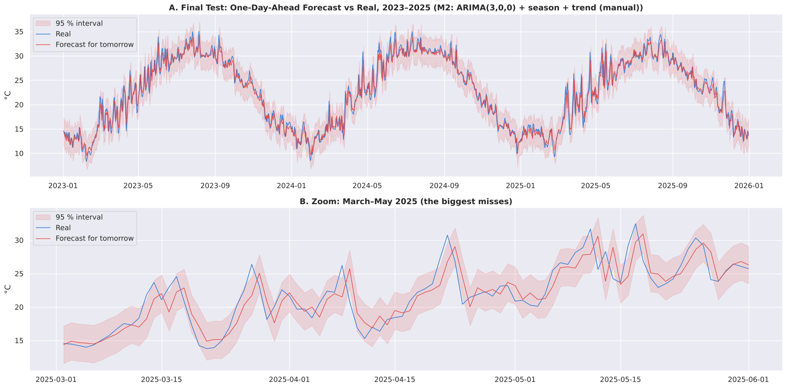

---

## Contents
1. [Goal](#goal)
2. [Results at a glance](#results-at-a-glance)
3. [Data](#data)
4. [Pipeline](#pipeline)
5. [Repository structure](#repository-structure)
6. [Part 1: Task 4, understanding the data](#part-1-task-4-understanding-the-data)
7. [Part 2: Task 5, forecasting](#part-2-task-5-forecasting)
8. [The storm story](#the-storm-story)
9. [Warnings: storms, rain and heat](#warnings-storms-rain-and-heat)
10. [RNN and LSTM](#rnn-and-lstm)
11. [Model comparison](#model-comparison)
12. [Task 4 vs Task 5](#task-4-vs-task-5)
13. [Why is Cairo getting hotter?](#why-is-cairo-getting-hotter)
14. [Next steps](#next-steps)
15. [Limitations](#limitations)
16. [How to run](#how-to-run)

---

## Goal

Forecast two things for tomorrow, and check the forecasts on the days that matter most: the storms, heat waves and cold snaps found in Task 4.

| Target | Task | Definition | Number to beat (Task 4) |
|---|---|---|---|
| Mean temperature | Regression | `temp_mean` of the next day (°C) | MAE 1.07 °C (validation), 1.04 °C (test): "tomorrow = today" |
| Rain | Classification | Next day has ≥ 1 mm of rain (yes / no) | F1 0.36 (validation), 0.47 (test): "rain today → rain tomorrow" |

---

## Results at a glance

- **Temperature:** ARIMA(3,0,0) with the yearly season (3 sine/cosine pairs) and a warming trend forecasts tomorrow with MAE 0.940 °C on 2023–2025, against 1.038 °C for "tomorrow = today" (9.5 % lower). It is better in every test year and in 13 of 13 walk-forward years.
- **Deep learning:** an LSTM (0.929 °C) and a Simple RNN (0.934 °C) reach the same accuracy. The gap on validation is below 0.01 °C, so the simpler SARIMAX model is kept.
- **Storms:** the temperature forecast misses the storm day (1.65 °C, against 1.00 °C the day before). Combined signs give a one-day warning: after rain with falling pressure, a storm follows on 20.4 % of days, against 1.2 % on an ordinary rainy-season day. Storms that start on a dry day give no sign.
- **Heat:** a very hot day (max > 40.1 °C) can be warned of one day ahead, catching 77 % of them against 61 % for persistence.
- **Rain tomorrow:** a logistic model does not beat persistence on the test years (F1 0.42 vs 0.47).
- **Warming:** the model learns +0.24 °C per 10 years and is still 0.13 °C too cold in every test year.

---

## Data

| | |
|---|---|
| **Source** | [NASA POWER](https://power.larc.nasa.gov/) daily point API (free, no API key) |
| **Location** | Central Cairo, 30.04° N, 31.24° E (one grid cell of about 50 × 50 km) |
| **Period** | 1990-01-01 to 2025-12-31 · 13,149 days · no gaps, no duplicates |
| **Variables (8)** | `T2M`, `T2M_MAX`, `T2M_MIN` (mean / max / min temperature), `PRECTOTCORR` (rain), `RH2M` (humidity), `WS2M` (wind speed), `PS` (pressure), `WD2M` (wind direction) |
| **Units** | Already metric (°C, mm/day, %, m/s, kPa, degrees) |
| **Missing value code** | -999 |


---

## Pipeline

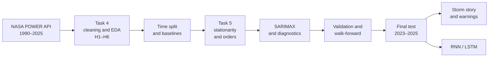

**Rules followed throughout:**
1. The raw data is never changed, and no rows are dropped.
2. Wrong values become NaN; only short gaps (≤ 3 days) are filled.
3. Real extreme days are kept, not capped.
4. Anything learned from the data (normals, thresholds, scalers, models) uses training years only.
5. Settings are chosen on validation; the test years are used once, at the end.

---

## Repository structure

```
├── Weather_Predication.ipynb           # Task 4: data collection, cleaning, EDA, H1–H6, baselines
├── Weather_Forecasting_v2.ipynb        # Task 5: SARIMAX, validation, storm story, warnings, RNN/LSTM
├── Cairo Weather Task 4 → Task 5.pptx  # presentation slides
├── cairo_raw_nasa_power.json           # raw API response
├── cairo_weather_raw.csv               # raw data as a table
├── cairo_weather_clean.csv             # cleaned data used by both notebooks
├── forecasts_test.csv                  # every test forecast (2023–2025) with the 95 % interval
├── sarimax_residuals_train.csv         # model residuals on the training years
├── 01_ … 17_*.png                      # Task 4 figures
├── 18_ … 27_*.png                      # Task 5 figures
└── README.md
```

| Task 5 step | What it covers |
|---|---|
| 1 · Recap | Clean data from Task 4, decisions carried over, the storm story |
| 2 · Preprocessing | Frequency, missing values, outliers, features, time split, scaling |
| 3 · Stationarity | ADF + KPSS, over-differencing check, differencing decision |
| 4 · Orders | Season as sine/cosine, ACF/PACF, manual orders, auto_arima |
| 5 · Fit and diagnostics | Four models, Ljung-Box, residual plots, model summary |
| 6 · Validation | One-day-ahead forecasts on 2020–2022, 95 % intervals, error by month and by horizon |
| 7 · Walk-forward | Refit every year: 3 folds for 3 models, 13 years for the chosen model |
| 8 · Final test | 2023–2025, run once; errors by year, month and type of day |
| 9 · Storm story | Forecast errors on Task 4's events, storm warning, rain tomorrow |
| 10 · RNN and LSTM | Training, validation and test against SARIMAX |
| 11 · Comparison | Comparison table and chart, Task 4 vs Task 5 |
| 12 · Sharper questions | Heat warning (Q3), bias in hot weather (Q4) |

---

## Part 1: Task 4, understanding the data

| Step | Method | Main finding |
|---|---|---|
| Preparation | Date index, gaps, duplicates, -999 and invalid angles → NaN, impossible values | 13,149 days, no gaps; wind direction invalid from 2013 (36 % of the column) |
| Descriptive | Summary stats, skew, rain-day counts, histograms | Temperature has two peaks (winter ~13 °C, summer ~29 °C); only 2.9 % of days have ≥ 1 mm of rain |
| Temporal patterns | Rolling means, yearly trend, monthly boxplots, weekly check, rolling std | Season dominates; warming (H1); rain jump in 2016 (H3); April moves most (3.4 °C), August least (1.2 °C) |
| Decomposition and structure | Additive vs multiplicative, ACF / PACF, ADF | Season 19.1 °C, trend 2.8 °C, residual 2.2 °C; only the last few days matter; stationary |
| Relationships and anomalies | Correlation (raw and deseasonalized), rolling-window outliers | Raw links shrink once the season is removed (pressure −0.79 → −0.34); 104 outliers that match real events, kept |


### Hypotheses H1–H6

| # | Question | Answer (Task 4) |
|---|---|---|
| H1 | Is Cairo warming, and are nights warming faster than days? | Yes. Nights +0.41 °C, days +0.23 °C per 10 years |
| H2 | Are very hot days (max > 40.1 °C) becoming more frequent? | Partly. 2023 and 2024 are the highest years |
| H3 | Did heavy rain really increase after 2016, or did the data change? | Most likely the data; rain work uses 2016–2025 only |
| H4 | Are cold waves (min < 5.7 °C) becoming rarer? | Yes, slowly. 20.4 nights per year (1990s) to 15.5 (2020s) |
| H5 | Do storms show warning signs in the days before? | Partly. Heat waves and cold snaps build up over days; storms don't |
| H6 | Can Khamasin-like days be detected? | Yes. 125 days in 1990–2012, mostly December to April |

| Yearly max and min temperature (H1) | Storms vs rain over 36 years (H3) |
|---|---|
|  |  |

| Top 10 storms in 36 years | Storm anatomy: 22 Mar 1991 vs 12 Mar 2020 |
|---|---|
|  |  |

### Baselines (numbers to beat)

| Baseline | Val MAE | Test MAE |
|---|---|---|
| Persistence (tomorrow = today) | 1.07 | 1.04 |
| Mean of last 7 days | 1.59 | 1.54 |
| Climatology (normal for tomorrow) | 1.84 | 1.79 |
| Same day last year | 2.56 | 2.27 |

For rain, the best baseline is persistence ("rain today → rain tomorrow"): F1 0.36 on validation and 0.47 on test.


---

## Part 2: Task 5, forecasting

### Time split

| | Temperature | Rain |
|---|---|---|
| Train | 1990–2019 · 10,957 days | 2016–2020 · 1,827 days |
| Validation | 2020–2022 · 1,096 days | 2021–2022 · 730 days |
| Test | 2023–2025 · 1,095 days | 2023–2025 · 1,095 days |

### Stationarity

| Series (1990–2019) | ADF | KPSS (constant level) | KPSS (trend) |
|---|---|---|---|
| Temperature as it is | Stationary (p < 0.001) | Stationary | Stationary |
| Season removed | Stationary (p < 0.001) | Not stationary (p ≤ 0.01) | Stationary |
| Daily change | Stationary (p < 0.001) | Stationary | Stationary |

The two tests disagree only once the season is removed: the series is stationary around a trend, not a random walk. After one difference, the ACF values of the series add up to −0.50, which is a sign of over-differencing. Decision: d = 0, D = 0, plus a trend term.

### Season and orders

Task 5's template uses SARIMA with m = 24 for hourly data. This data is daily, so the cycle is the year (m = 365), which is too heavy for SARIMA on 10,957 days. The season is modeled with Fourier terms instead: 3 sine/cosine pairs of the day of year explain 89 % of the daily temperature. The trend is +0.27 °C per 10 years (1990–2019).

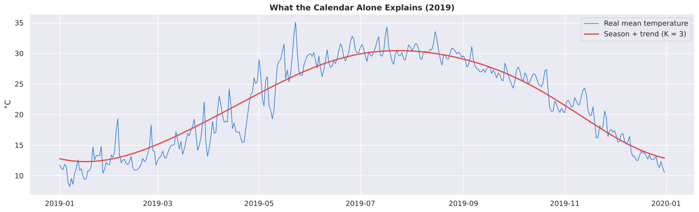

After removing the season and trend, the ACF tails off (0.76, 0.47, 0.31, …) and the PACF stops after lag 3 (0.76, −0.24, 0.11). This points to ARIMA(3,0,0), chosen before running `auto_arima`.

| Choice | Order | AIC | BIC | Parameters |
|---|---|---|---|---|
| Manual (PACF) | (3,0,0) | 38,965.1 | 39,052.7 | 12 |
| auto_arima | (3,0,3) | 38,934.1 | 39,043.6 | 15 |

The 3 extra MA terms improve the AIC but barely the BIC, so both orders go to validation.

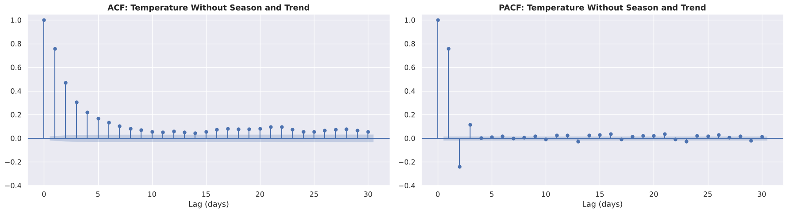

### Models and residuals

| Model | Inputs | Ljung-Box p (lag 7) |
|---|---|---|
| M1: ARIMA(3,0,0) | Level only, no season | < 0.001 |
| M2: ARIMA(3,0,0) | Level, trend, season | 0.26 |
| M3: ARIMA(3,0,3) | Same as M2 (auto_arima order) | 0.007 |
| M4: ARIMA(3,0,0) | M2 + yesterday's humidity and pressure | 0.39 |

M2 leaves no memory from the last week in its residuals. At lag 30 every model fails the test: with about 11,000 days, Ljung-Box flags even very small links (the largest residual autocorrelation is about 0.05). The residuals have heavy tails (kurtosis 5.6), which come from the storms, desert-wind days and cold snaps found in Task 4.

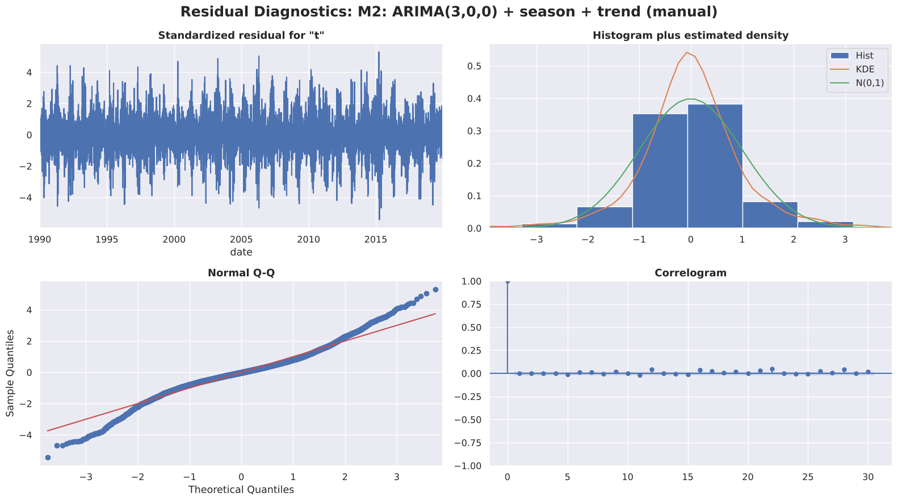

### Validation and walk-forward

| Forecast | Validation MAE (2020–2022) | Walk-forward mean (2020–2022) |
|---|---|---|
| M3 | 0.990 | 0.990 |
| M2 (chosen) | 0.992 | 0.991 |
| M4 | 0.994 | 0.993 |
| M1 (no season) | 1.032 | – |
| Persistence | 1.072 | 1.072 |

The rule was fixed before the scores were seen: keep the simplest model (M2) unless another is better by more than 0.01 °C. Refitted every year on 2010–2022, M2 beats persistence in 13 of 13 years (gain 4.5–13.2 %, 8.8 % on average). The forecast beats climatology up to 6 days ahead; from day 7 it becomes the normal for the date.

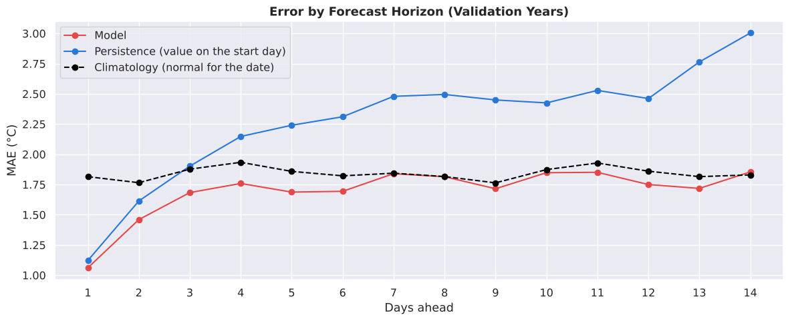

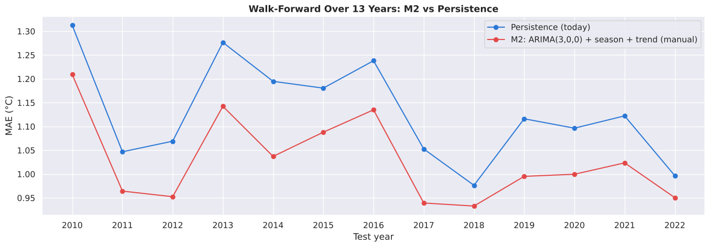

### Final test (2023–2025)

| | MAE (°C) | RMSE (°C) | MAPE (%) | R² |
|---|---|---|---|---|
| M2 | 0.940 | 1.286 | 4.54 | 0.965 |
| Persistence | 1.038 | 1.443 | 5.01 | 0.956 |

- M2 is better in every year: 2023 (0.955 vs 1.080), 2024 (0.886 vs 0.974), 2025 (0.977 vs 1.061).
- 95.1 % of real values fall inside the 95 % interval overall, but only 82–85 % in March–May.
- The forecast is 0.13 °C too cold on average, in every test year.

---

## The storm story

Events use the Task 4 definitions: storms (first day of rain ≥ 10 mm, 2016–2025), heat waves (max ≥ 2 std above normal) and cold snaps (min ≥ 2 std below normal). M2's one-day-ahead forecasts for 2020–2025:

| Days (2020–2025) | Number | MAE model (°C) | MAE persistence (°C) | Bias (real − forecast) |
|---|---|---|---|---|
| Ordinary days | 2,120 | 0.93 | 1.04 | 0.00 |
| Storm: day before | 13 | 1.00 | 0.76 | −0.24 |
| Storm: first day | 13 | 1.65 | 1.30 | −1.05 |
| Storm: day after | 13 | 0.81 | 0.57 | −0.07 |
| Heat wave: first day | 52 | 2.06 | 1.62 | +2.05 |
| Cold snap: first day | 6 | 1.72 | 0.63 | −1.72 |

The model is better on ordinary days and worse on event days. On storm days it forecasts an ordinary day and is about 1 °C too warm; the day before shows no sign. The heat-wave days were chosen by what happened, which makes any forecast look too cold on them (see Q4).

The March 2020 storm: on 12 March the forecast was 18.3 °C and the real value 15.4 °C, 2.95 °C too warm. The two days before were also missed, in opposite directions (10 March 3.4 °C colder than forecast, 11 March 3.1 °C warmer). On 13 March, the day of the lowest pressure in 36 years (98.32 kPa), the error was 0.25 °C.

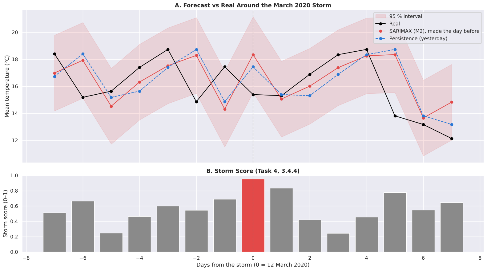

The error is highest at both ends of the Task 4 storm score: the stormiest 10 % of days (1.14 °C) and the calmest 10 % (1.40 °C, sudden warm and dry days), against 0.75–0.90 °C in the middle.

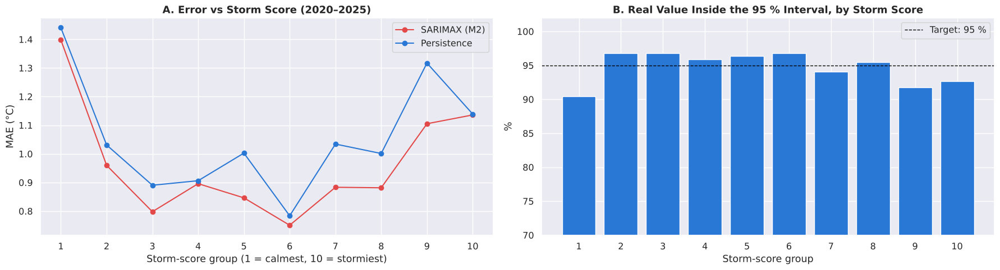

---

## Warnings: storms, rain and heat

### Storm warning (2016–2025)

Task 4 tested each sign alone (all correlations below 0.06). Combined, they give more information:

| Signs today (rainy season) | Storms next day | Chance |
|---|---|---|
| Any day | 25 of 2,084 | 1.2 % |
| Rain today | 13 of 121 | 10.7 % |
| Rain today + falling pressure | 10 of 49 | 20.4 % |
| Rain today + humid | 5 of 64 | 7.8 % |
| Dry today | 12 of 1,963 | 0.6 % |

Storms that start after rain give a one-day warning; the 12 storms that start on a dry day give none. A logistic regression trained on 15 storms did not do better than this rule on the 6 test storms (CSI 0.13 vs 0.11), so the rule is kept.

### Rain tomorrow

| | Validation F1 | Test F1 |
|---|---|---|
| Logistic regression | 0.41 | 0.42 |
| Persistence (rain today) | 0.36 | 0.47 |

The model helps in the wetter validation years and not in the drier test years. Persistence remains the rain forecast.

### Q3: very hot day warning (max > 40.1 °C)

| Days ahead | Caught on test (of 93): model vs persistence | Test F1: model vs persistence |
|---|---|---|
| 1 | 72 vs 57 | 0.63 vs 0.61 |
| 2 | 72 vs 42 | 0.49 vs 0.45 |
| 3 | 65 vs 36 | 0.44 vs 0.39 |

Heat builds up over several days, and a logistic regression on the recent days catches more very hot days than persistence at every lead, with more false alarms.

### Q4: is the forecast too cold in hot weather?

| Test days | Number | Bias (real − forecast) |
|---|---|---|
| All test days | 1,095 | 0.13 °C |
| Chosen by what happened (hottest 5 %) | 131 | 0.88 °C |
| Chosen in advance (forecast above the hot threshold) | 101 | 0.11 °C |
| Chosen in advance (after 3+ warm days in a row) | 323 | 0.12 °C |

On hot days chosen in advance, the bias is the same as on all days. The 0.88 °C comes from selecting days after the fact. Adding warm-spell inputs to M2 leaves the validation MAE at 0.992 °C.

---

## RNN and LSTM

| Setting | Value |
|---|---|
| Library | PyTorch (same layers as the Keras code in the task) |
| Input | Last 30 days: temperature (scaled on training years only) and day of year as sine/cosine |
| Simple RNN | SimpleRNN(32) → Dense(1) |
| LSTM | LSTM(64) → Dropout(0.2) → LSTM(32) → Dense(1) |
| Training | Adam, MSE, batch 32, early stopping (patience 5) on 2017–2019; refit on 1990–2022 for the test |

| | Validation MAE | Test MAE |
|---|---|---|
| LSTM | 0.982 | 0.929 |
| Simple RNN | 0.985 | 0.934 |
| SARIMAX M2 | 0.991 | 0.940 |

Both networks are within 0.01 °C of M2 on validation, so M2 is kept: it reaches the same accuracy with 12 parameters and gives a 95 % interval.

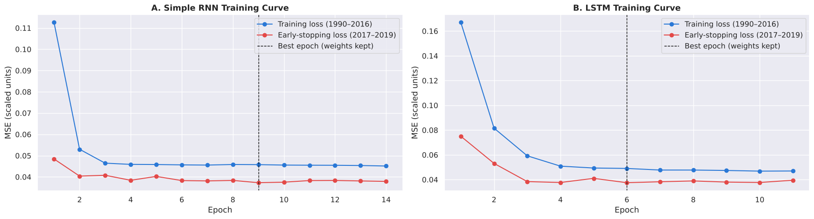

---

## Model comparison

Test years 2023–2025. The last column is the MAE on the 35 first days of Task 4's events in the test years.

| Model | MAE (°C) | RMSE (°C) | MAPE (%) | Gain vs persistence | MAE on event days |
|---|---|---|---|---|---|
| LSTM | 0.929 | 1.270 | 4.49 | 10.5 % | 1.84 |
| Simple RNN | 0.934 | 1.275 | 4.51 | 10.1 % | 1.93 |
| M3: ARIMA(3,0,3) + season + trend | 0.937 | 1.282 | 4.55 | 9.8 % | 1.86 |
| M4: M2 + humidity and pressure | 0.937 | 1.277 | 4.53 | 9.7 % | 1.85 |
| M2: ARIMA(3,0,0) + season + trend (chosen) | 0.940 | 1.286 | 4.54 | 9.5 % | 1.90 |
| M1: ARIMA(3,0,0), no season | 0.984 | 1.368 | 4.76 | 5.2 % | 1.63 |
| Persistence | 1.038 | 1.443 | 5.01 | – | 1.54 |
| Climatology | 1.794 | 2.326 | 8.66 | −72.8 % | 4.44 |

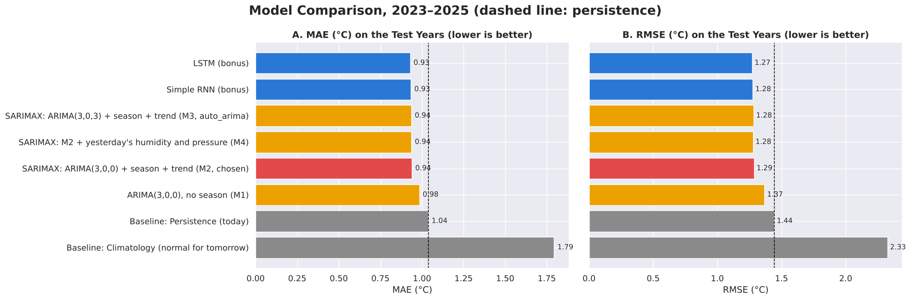

---

## Task 4 vs Task 5

Task 4 answered the questions by describing 1990–2025. Task 5 checks them with forecasts on years the models never saw.

| Question | Task 4 | Task 5 | Verdict |
|---|---|---|---|
| H1 Warming | Nights +0.41, days +0.23 °C per 10 years | Trend +0.24 °C per 10 years in the model; still 0.13 °C too cold on 2023–2025 | Confirmed |
| H2 Very hot days | Partly | 17.2 a year (1990–2019), 31.0 a year (2023–2025); warned 1–3 days ahead (Q3) | Strengthened |
| H3 Rain after 2016 | Data change | Not tested again; rain work uses 2016–2025 | Used |
| H4 Cold waves | Rarer, slowly | 18.1 a year (1990–2019), 21.0 (2020–2022), 9.7 (2023–2025) | Confirmed |
| H5 Storm warning | Partly; each sign alone shows little | Rain + falling pressure: 20.4 % chance of a storm tomorrow; no sign after a dry day | Refined |
| H6 Khamasin | 125 days in 1990–2012 | No wind direction after 2012; only a similar hot, dry pattern | Not testable |
| Humidity and pressure help | Yes (correlations) | Pressure is significant, but the forecast does not improve (0.937 vs 0.940 °C) | Changed |

---

## Why is Cairo getting hotter?

Possible causes. These are not results of the models.

| Possible cause | What is known | Can this data test it? |
|---|---|---|
| Regional and global warming | The Mediterranean region has warmed about 1.4 °C since pre-industrial times, faster than the global average | Yes. The +0.24–0.27 °C per 10 years measured here fits it |
| Loss of trees and green space | About 911,000 m² of green space lost in Cairo in 2017–2020; green and water areas were 5–6 °C cooler than the hottest built-up areas in the June 2022 heatwave | No |
| Buildings and asphalt over farmland | Summer land surface temperature in Greater Cairo rose from 31.3 °C (1986) to 36.0 °C (2017) | No |
| Factories, traffic, air conditioning | Waste heat and pollution add heat inside the city (hypothesis) | No |

The data cannot test the city-level causes: each value is an average over a cell of about 50 × 50 km, and the model behind NASA POWER (MERRA-2) keeps vegetation on a fixed seasonal cycle. The two large changes after 2013 were in the data, not in the weather: wind direction (2013) and rain amounts (2016).

Sources: [Enterprise (Reuters, Arup)](https://enterpriseam.com/egypt/goinggreens/egypts-urban-heat-problems-are-growing-and-the-govt-is-searching-for-solutions/), [Urbanisation and land surface temperature in Greater Cairo (2022)](https://doaj.org/article/4bd430eef970404d8f2bca6fb535546f), [The New Arab](https://newarab.com/features/tree-cutting-egypt-sparks-fury-heatwave-hits-record-highs), [NASA Earthdata forum on MERRA-2 vegetation](https://forum.earthdata.nasa.gov/viewtopic.php?p=10211).

---

## Next steps
1. A 95 % interval whose width changes with the season (wider in spring).
2. Check the heat warning (Q3) on more years.
3. A storm warning built on hourly data or pressure from upstream stations, judged against the rule found here.
4. Street-level data (satellite land surface temperature, city stations) to measure the effect of green-space loss.
5. Deployment with the same variables from Open-Meteo, so the model is trained on the source it will use live.

## Limitations
- Model data, not a station: values are averages over about 50 × 50 km, so extremes may look milder.
- Few rare events: 25 storms in 2016–2025 (6 in the test years) and 6 cold snaps in 2020–2025.
- Rain amounts are the weakest variable; they jump in 2016 (H3).
- Wind direction is valid for 1990–2012 only.
- The 95 % interval has the same width all year, so it is too narrow in spring.

## How to run

```bash
pip install requests numpy pandas matplotlib seaborn statsmodels pmdarima scikit-learn torch jupyter
jupyter notebook Weather_Predication.ipynb     # Task 4
jupyter notebook Weather_Forecasting_v2.ipynb  # Task 5, about 10 minutes
```

The raw API response (JSON) and the raw and clean CSV files are included. Task 5 starts from `cairo_weather_clean.csv`, and its seeds are fixed, so a full run reproduces the numbers above.
